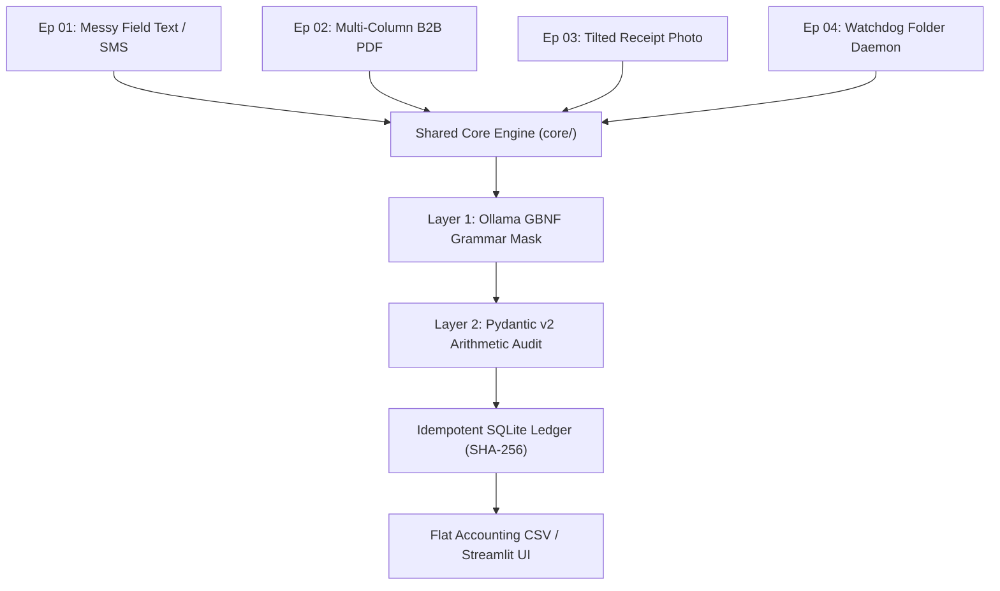

# Code Architecture & Walkthrough Guide

> [!IMPORTANT]
> **Source Code Line-Number Integrity:**
> To maintain strict 1:1 line-number synchronization with the recorded YouTube tutorial video series (*"Zero-Cloud ERP Engine on a Laptop"*), the Python source files in this repository are kept clean of noisy inline comments. 
> 
> This document serves as the **official architectural companion**, breaking down every file, class, function, and design decision without displacing any source code line numbers.

---

## 1. Architectural Philosophy: The 70% Shared Core

A common failure in multi-part software tutorials is rewriting or duplicating boilerplate across folders. In this project:
- **70% of the entire system resides in `core/`** and is shared unchanged by all 4 episodes.
- Each episode folder (`ep01` to `ep04`) acts as a **specialized input adapter** feeding the same immutable persistence and validation pipeline.

---

## 2. Core Modules Breakdown (`core/`)

### `core/schemas.py` — Two-Layer Deterministic Defense
* **Target Schema:**
  - `LineItem`: Captures `item_name`, `sku_or_part_no`, `quantity`, `unit_price`, and `line_total`.
  - `PurchaseOrderExtraction`: Captures `vendor_name`, `job_or_po_number`, `currency`, `items`, `stated_total`, `needs_human_review`, and `review_reasons`.
* **Layer 1 Defense (C++ Grammar Masking):**
  - Uses `pydantic.json_schema.SkipJsonSchema` on internal audit fields (`needs_human_review`, `review_reasons`).
  - When passed to Ollama (`format=PurchaseOrderExtraction.model_json_schema()`), the LLM only sees extraction targets. It is physically impossible for the model to hallucinate its own approval status.
* **Layer 2 Defense (`@model_validator(mode="after")` — Lines 81–110):**
  - **Deterministic Math Audit:** Pure Python evaluates `abs(quantity * unit_price - line_total) > 0.05`. If there is a mismatch (e.g. the $35 Grainger discrepancy in Scenario 4), it automatically flags `needs_human_review = True` and appends an audit message.
  - **Null Safety Audit:** Verifies that missing prices (Lowe's Scenario 2) or missing quantities (DigiKey Scenario 3) do not silently default to zero, but stay as explicit `None` (`null`) for accounting review.

### `core/llm_client.py` — Zero-Temp CPU Inference & Hardware Telemetry
* **`_ensure_ollama_running()` (Lines 18–45):**
  - Checks if TCP port `11434` is listening. If offline, automatically spawns `ollama serve` in the background with zero window flicker.
* **Why `qwen2.5:3b`?**
  - **Zero `<think>` Overhead:** Unlike hybrid reasoning models (`qwen3` / `qwen3.5`) that generate 200–500 internal reasoning tokens before emitting JSON, `qwen2.5:3b` emits `{` on the very first token.
  - **Memory Bandwidth Fit:** Occupies only **1.9 GB in RAM**, allowing laptop CPUs (AMD Ryzen 7 / Intel Core i7) to achieve **18–25 tokens/second** without thermal throttling.
* **Extraction Functions:**
  - `extract_two_layer(raw_text)`: Enforces GBNF grammar + Pydantic Layer 2 audit. Measures exact `wall_time_ms`, `eval_count`, and `tokens_per_sec`.
  - `extract_naive_unstructured(raw_text)`: Demonstrates the classic "before" failure mode where raw prompts hallucinate or break JSON.

### `core/database.py` — Idempotent SQLite Ledger & Relational Persistence
* **Relational Schema (`init_db()`):**
  - `purchase_orders` (Parent table): Stores `source_hash`, `vendor_name`, `stated_total`, `needs_human_review`, and audit reasons.
  - `line_items` (Child table): Linked via foreign key with `ON DELETE CASCADE`.
* **Idempotency via SHA-256 (Line 61 & Line 67):**
  - `compute_content_hash(raw_content)`: Generates a 16-character SHA-256 fingerprint of input text or file bytes.
  - `save_extraction()`: Before insertion, queries existing records for the same hash. If an employee double-clicks "Process" or uploads the same receipt twice, the old rows are atomically deleted and re-written in a single transaction, guaranteeing **zero double-counting** in company financials.
* **`fetch_all_line_items_flat()` (Line 135):**
  - Executes a single SQL `JOIN` mapping raw boolean flags into clean visual badges (`✅ APPROVED` vs `⚠️ REVIEW`) for Streamlit and CSV exports.

---

## 3. Episode Modules Walkthrough

### `ep01_structured_text/` (Part 1: Chaotic Field Messages to SQLite)
* **`cli_demo.py`:** Runs a live benchmark against all 5 real-world technician scenarios in `data/samples_ep1_text/`:
  1. *Clean Field SMS (Home Depot)* $\rightarrow$ Auto-approved ($207.00).
  2. *Missing Unit Price (Lowe's)* $\rightarrow$ Null audit quarantine.
  3. *Missing Quantity (DigiKey)* $\rightarrow$ 10k Ohm resistor trap avoided.
  4. *Arithmetic Mismatch (Grainger)* $\rightarrow$ Layer 2 catches $35 discrepancy.
  5. *Chaotic Speech-to-Text (AutoZone)* $\rightarrow$ Resolves Job 701, isolates unpriced fluid.
* **`app_streamlit.py`:** Visual web dashboard (`http://127.0.0.1:8501`) featuring live text testing, telemetry display, and QuickBooks CSV ledger export.

### `ep02_pdf_tables/` (Part 2: Visual Table X-Ray for PDF Invoices)
* **`pdf_parser.py`:**
  - Explains why `pypdf` destroys multi-column tables (Mouser, DigiKey) by flattening columns into text salad.
  - Uses `pymupdf4llm` to perform geometric layout analysis, converting vector lines and whitespace coordinates directly into GitHub-Flavored Markdown tables (`| Item | Qty | Price |`).
  - Feeds the clean Markdown into `core/schemas.py`, achieving 100% column preservation on laptop CPU.
* **`cli_demo.py`:** Executes the side-by-side comparison between standard extraction vs. Table X-Ray.

### `ep03_fast_cpu_ocr/` (Part 3: 20x Faster Receipt OCR on Pure CPU)
* **`ocr_pipeline.py`:**
  - Explains why 11B Vision LLMs take 80+ seconds on CPU (memory bandwidth bottleneck).
  - Implements a Two-Stage CPU Pipeline:
    1. **`RapidOCR` (ONNX Runtime):** Extracts bounding boxes and text from skewed thermal receipt photos in **435 ms**.
    2. **12-Line Y-Coordinate Row Sorter:** Clusters text boxes by vertical Y-axis tolerance, keeping descriptions and prices on the exact same row before passing text to `qwen2.5:3b`.
* **`cli_demo.py`:** Runs OCR and structured extraction on `data/samples_ep3_images/tilted_fastenal_receipt.png`.

### `ep04_watchdog_daemon/` (Part 4: Autonomous Watch-Folder Robot)
* **`watcher_service.py`:**
  - Uses Python `watchdog` to monitor `data/incoming_watch/`.
  - Auto-routes incoming `.txt`, `.pdf`, and `.png` files to their respective extractors.
  - Enforces SHA-256 deduplication and automatically sorts files into `data/processed_watch/approved/` or `data/processed_watch/quarantine_review/` with zero human clicks.

---

## 4. How to Adapt for Your Own ERP / Accounting System

To tailor this engine to your company's workflows:
1. Open `core/schemas.py` and modify `PurchaseOrderExtraction` fields to match your ERP (SAP, Odoo, QuickBooks, NetSuite).
2. Adjust the Layer 2 validation rules in `@model_validator` to enforce your internal business policies (e.g. mandatory Job Number, tax tolerance, or spending limits).
3. The rest of the pipeline (GBNF grammar lock, Ollama auto-starter, SQLite persistence, and watch-folder daemon) will adapt automatically.
